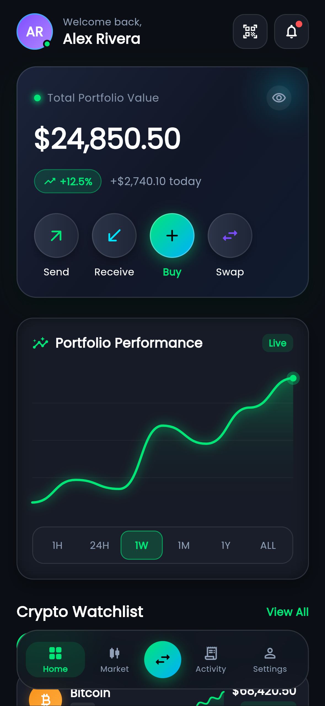
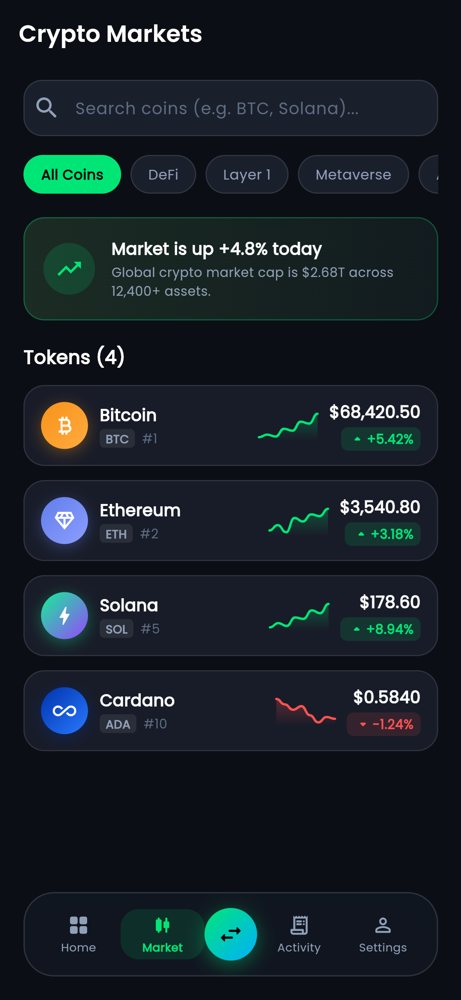
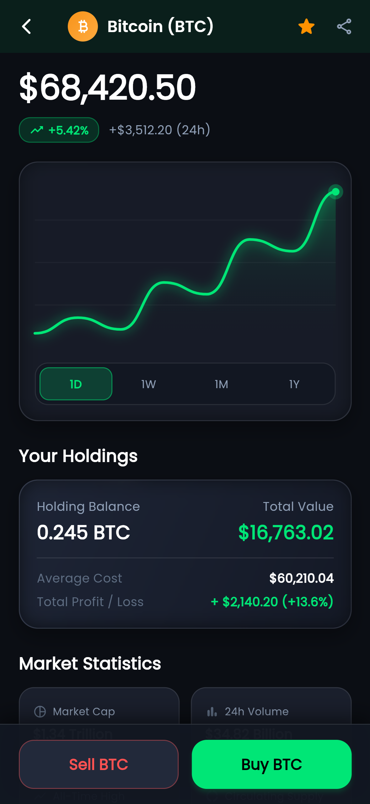

# 🚀 Apex Crypto Wallet - Flutter App

A modern, secure, and intuitive cryptocurrency wallet & trading platform UI built using **Flutter**.

## 📱 App Screenshots

  
  
  

## ✨ Features
- 📊 Real-time Portfolio Tracking
- 🔄 Crypto Swapping & Token Management
- 📈 Interactive Live Market Charts
- 🔒 Secure Wallet Interface

## 🛠 Tech Stack
- **Framework:** Flutter (Dart)
- **State Management:** Provider / BLoC
- **UI Architecture:** Clean & Responsive Design